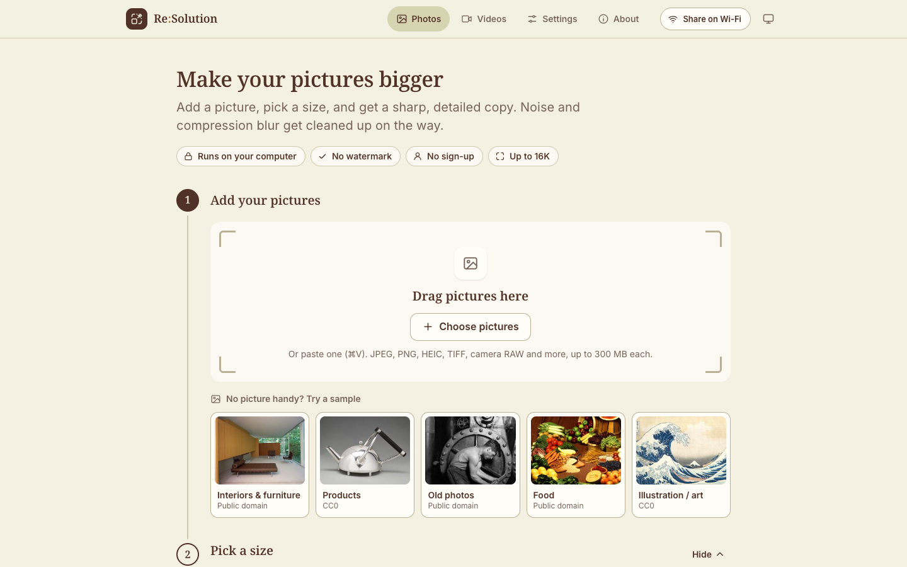
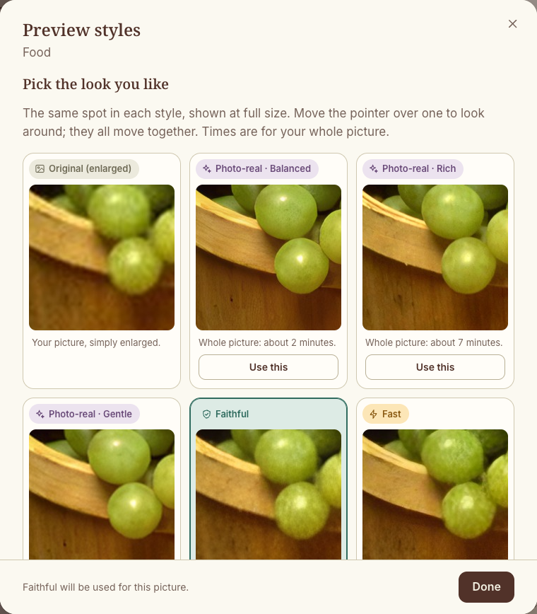
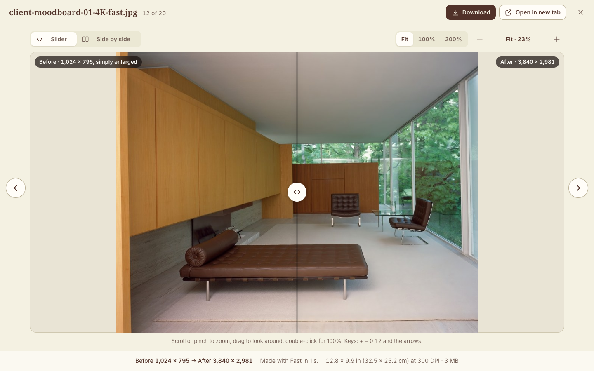
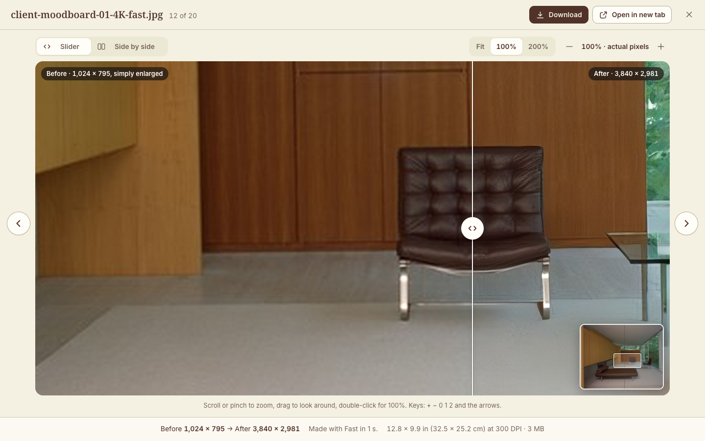
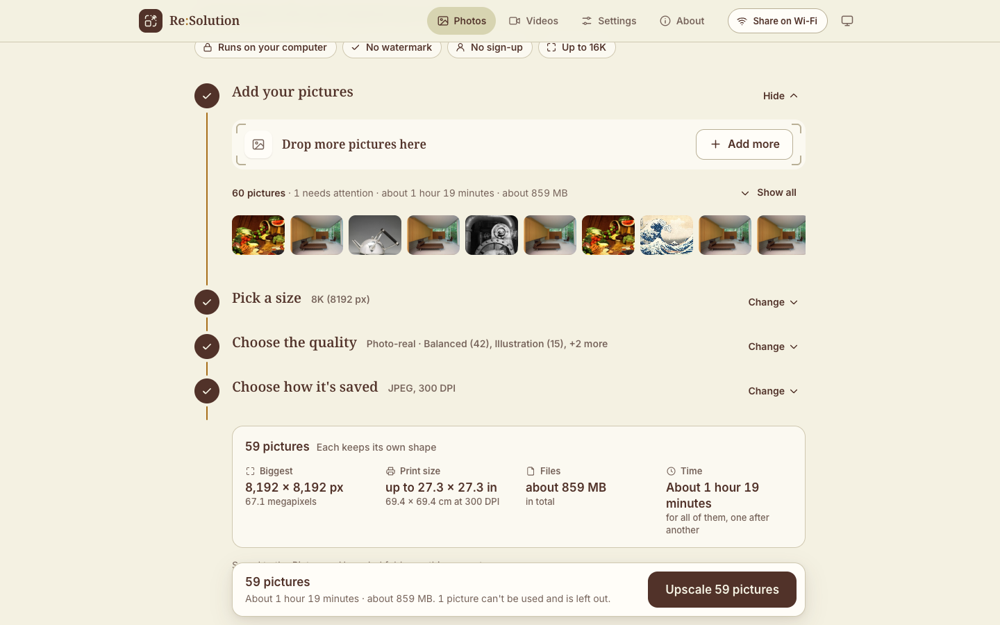
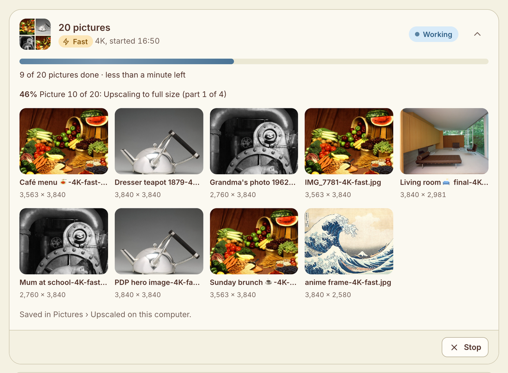
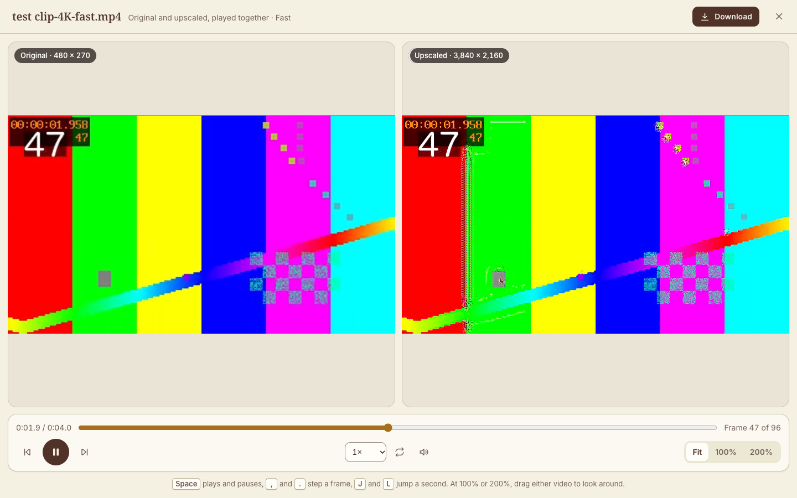
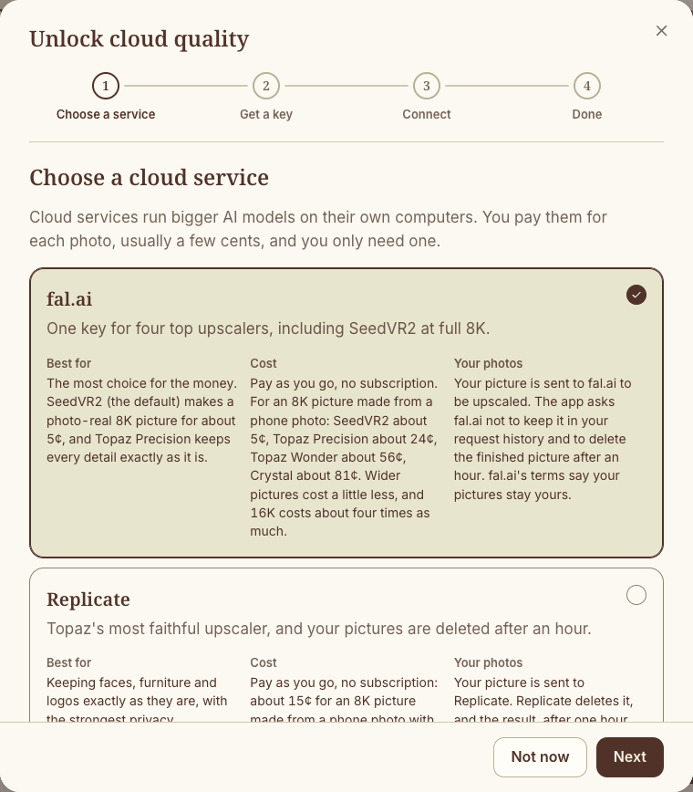
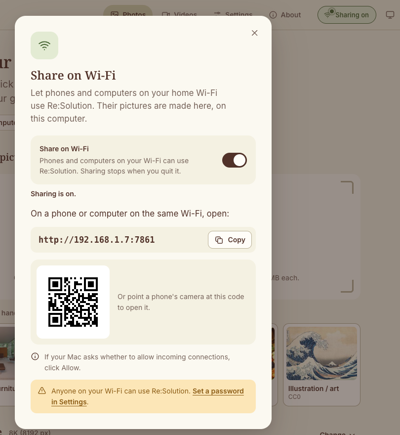
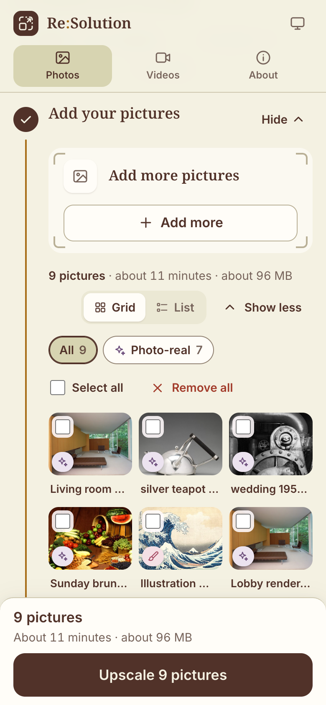

<h1 align="center">Re:Solution</h1>

<p align="center">
  <strong>More resolution. Problem solved.</strong><br>
  A free app that makes your pictures up to 16K and your videos 4K, right on your own computer.
</p>

<p align="center">
  <a href="#install-in-one-line">Install</a> ·
  <a href="#what-it-does">What it does</a> ·
  <a href="#how-long-it-takes">How long it takes</a> ·
  <a href="#share-on-wi-fi">Share on Wi-Fi</a> ·
  <a href="#troubleshooting">Help</a>
</p>



Re:Solution (resolution, plus solving a problem) takes a small or soft picture and makes a big, sharp, detailed copy at 4K, 6K, 8K or even 16K. It turns videos into 4K with their sound kept. It cleans up noise and compression blur on the way, and it keeps your picture's own colours: only the fine detail is new.

It runs in your web browser, but all the work happens on your computer. There's no sign-up and no watermark, and nothing is uploaded unless you choose a cloud service yourself. It's free and open source (MIT licence).

**Contents:** [Install](#install-in-one-line) · [What it does](#what-it-does) · [How long it takes](#how-long-it-takes) · [Video](#video-to-4k) · [Cloud quality](#cloud-quality-optional) · [Share on Wi-Fi](#share-on-wi-fi) · [Designers' notes](#designers-notes) · [Troubleshooting](#troubleshooting) · [Updating](#updating) · [Uninstalling](#uninstalling) · [Credits](#credits)

## Install in one line

### What you need

- **A Mac** with Apple Silicon (M1 or newer) and macOS 14 Sonoma or newer. Photo-real, the default mode for pictures, needs 16 GB of memory. On an 8 GB Mac, Re:Solution uses Faithful instead and tells you so.
- **Or a Windows 10 or 11 PC** (64-bit, Intel or AMD). An NVIDIA graphics card makes it fast: a GeForce RTX 20 or GTX 16 series card or newer, with driver 580 or newer. Without one it still works, on the processor, just slowly. Older NVIDIA cards, such as the GTX 10 series or a Titan V, can't run the graphics software Re:Solution uses, so on those it uses the processor by itself. Photo-real needs a card with 12 GB of its own memory. Windows support is new: see [Notes from the maintainer](#notes-from-the-maintainer).
- **Internet** for the install and the first time you use each mode. After that it works offline, apart from cloud modes.
- **Disk space:** about 2 GB (about 6 GB on a PC with NVIDIA), plus 7.3 GB if you use Photo-real, plus room for your results (finished jobs also keep a copy of each original for a week, for comparing). A 16K TIFF is about 360 MB.

### On a Mac

1. Open **Terminal**: press **Command-Space**, type `Terminal` and press **Return**.
2. Copy this line, paste it into Terminal and press **Return**:

   ```bash
   curl -fsSL https://raw.githubusercontent.com/swatisrivastava1010/re-solution/main/install.sh | bash
   ```

3. Wait a few minutes while it downloads about 400 MB. It doesn't need your password, and it leaves your Mac's settings alone.
4. Re:Solution opens in your web browser. Next time, double-click **Re-Solution** on your Desktop. It's also in the Applications folder inside your home folder, or press **Command-Space** and type `Re-Solution`.

The first time you open the Re-Solution app, your Mac asks whether "Re-Solution" may control "Terminal". Click **OK**: that's how it starts its engine. If your Mac asks whether Terminal may use a folder such as your Desktop, click **Allow**.

### On Windows

1. Open **PowerShell**: click **Start**, type `PowerShell` and press **Enter**. You don't need "Run as administrator".
2. Copy this line, paste it into PowerShell and press **Enter**:

   ```powershell
   irm https://raw.githubusercontent.com/swatisrivastava1010/re-solution/main/install.ps1 | iex
   ```

3. It checks your graphics card and downloads what it needs: about 3 GB with an NVIDIA card, or about 400 MB without one. Allow 10 minutes or more.
4. Re:Solution starts in a new window and opens in your browser. Next time, use **Re-Solution** in the Start menu or on the Desktop.

Both installers give Re:Solution a folder of its own: `~/Applications/Re-Solution` on a Mac and `%LOCALAPPDATA%\Re-Solution` on Windows. While Re:Solution runs, a window full of text stays open (Terminal on a Mac, a black window on Windows). That's its engine room: leave it open, and close it when you want to stop Re:Solution.

### Another way: download the zip

For anyone who'd rather not paste a command, or who got the folder from a friend.

1. On this GitHub page, click the green **Code** button, then **Download ZIP**.
2. Unpack it somewhere it can stay, in a folder that iCloud Drive, OneDrive, Dropbox or Google Drive doesn't sync. Your home folder is a good choice: on a Mac, choose **Go → Home** in Finder; on Windows, it's `C:\Users\` followed by your name. The folder inside is called `re-solution-main`.
   - **Why not Desktop or Documents?** iCloud (on a Mac) and OneDrive (on Windows) often sync those two folders. The first start builds over 1 GB of parts inside Re:Solution's folder. A syncing service would upload all of it, and it may later clear the copies off your computer to save space, so Re:Solution starts slowly or not at all when you're offline.
   - **Windows:** first right-click the zip, choose **Properties**, tick **Unblock** if you see it and click **OK**. Then right-click it again and choose **Extract All**. Don't run Re:Solution from inside the zip.
3. Double-click **Start Re-Solution.command** (Mac) or **Start Re-Solution.bat** (Windows, where it may just show as "Start Re-Solution").

The first start installs a small helper called uv, then the app's parts: about 400 MB, or about 3 GB on a PC with an NVIDIA card. Later starts take a few seconds.

<details>
<summary><strong>Mac: "Apple could not verify 'Start Re-Solution.command' is free of malware"</strong></summary>

Macs say this about anything that doesn't come from the App Store or a registered developer. It's safe, and you only do this once.

1. Click **Done** (not "Move to Bin").
2. Open **System Settings → Privacy & Security**.
3. Scroll down to **Security**. Next to the message about "Start Re-Solution.command", click **Open Anyway**.
4. Click **Open Anyway** again and enter your Mac password (or use Touch ID).

If double-clicking still doesn't work (for example "you do not have appropriate access privileges"): open Terminal, type `bash` and a space, drag **Start Re-Solution.command** into the Terminal window, and press **Return**.

</details>

<details>
<summary><strong>Windows: "Windows protected your PC"</strong></summary>

Click **More info**, then **Run anyway**. If you see "The publisher could not be verified", click **Run**. Unblocking the zip before you unpack it (step 2 above) usually avoids these messages.

</details>

<details>
<summary><strong>Passing your copy on to someone else</strong></summary>

The easiest way is to send them the link to this page. If you zip up your own folder instead, leave out the hidden `.venv` folder: it holds 1 GB or more of parts built for your computer only, and Re:Solution rebuilds it on the next start. On a Mac, press **Command-Shift-.** in Finder to show hidden folders.

</details>

### The first start

- Your browser opens Re:Solution at `http://127.0.0.1:7860`. If it doesn't, type that address into your browser.
- The first time you use **Photo-real**, Re:Solution asks to download its model: a one-time 7 GB download, about 10 minutes on fast Wi-Fi. Click **Download now**, or **Use Faithful this time** if you'd rather wait. On Windows it also installs a small Photo-real add-on.
- Each other mode downloads its own model the first time you use it, between about 5 MB and 140 MB.

## What it does

Give Re:Solution a picture and it draws a bigger version with real-looking detail: fabric weave, wood grain, hair, leaves. A plain resize just gives you a big, blurry copy. Your picture's colours and tones always stay as they were.

### Quality modes

Each mode has its own colour and icon, used everywhere in the app, so you can always tell which one made a picture.

| Mode | Good for | Model |
|---|---|---|
|  **Photo-real** (violet, the default) | Making AI images and photos look like genuine high-resolution photos. Sharpens, cleans up noise and compression, and adds natural new detail. | SeedVR2-3B |
|  **Faithful** (teal) | Keeping faces, logos, text and furniture shapes exactly as they are, while sharpening and cleaning up. | 4xBHI_dat2_real |
|  **Faithful for sharp photos** (teal, under "More modes") | Camera photos that are already clean and sharp. | 4xNomos2_hq_dat2 |
|  **Fast** (amber) | Results in seconds, for trying things out. | 4x-ClearRealityV1 |
|  **Illustration** (pink) | Drawings, cartoons and anime, with clean lines and flat colours. | RealESRGAN_x4plus_anime_6B |
|  **Cloud** (sky blue, optional) | Paid services you connect yourself. See [Cloud quality](#cloud-quality-optional). | fal.ai, Replicate, Magnific |
|  **Video** (indigo) | Videos to 4K. See [Video to 4K](#video-to-4k). | 4x-ClearRealityV1 and others |

Jobs show their state the same way: grey while waiting, blue while working, green when done and red if there's a problem, always with an icon and a word too.

Photo-real **invents** fine detail, so the app reminds you: "Photo-real invents fine detail. Check faces, logos and text, or switch to Faithful."

### Sizes up to 16K

- **4K, 6K, 8K or 16K** make the long side 3,840, 6,144, 8,192 or 16,384 pixels. 8K is the default.
- **8K TV** and **16K TV** fit the picture inside 7,680 × 4,320 or 15,360 × 8,640, turned for portrait pictures.
- **2×, 3× or 4× bigger** multiply both sides.

Before you start, a readout shows the final size, how big it prints, the file size and how long it will take. 16K usually takes two AI passes (your mode, then the Fast model to full size), and Re:Solution warns you first if the disk is short of space. On a screen, 16K looks the same as 8K: it's for big prints.

If a picture is already bigger than the size you picked, Re:Solution saves a copy and tells you. A small picture (under about 1,600 pixels going to 8K) needs two passes and can look a little painted; the app warns you when that happens.

### Photo-real's three detail levels

All three use SeedVR2. Pick one under the Photo-real card.

| Level | How it works | 2K picture to 8K on an M4 Mac | What it looks like |
|---|---|---|---|
| **Balanced** (default) | SeedVR2 doubles the size, then the Fast model takes it to full size | about 3–6 minutes | Natural detail with crisp edges. Right for most pictures |
| **Rich** | SeedVR2 makes it 4× bigger | about 10–22 minutes | The most new detail. Can make food and other natural surfaces look over-textured |
| **Gentle** | SeedVR2 doubles the size, then a plain resize | about 3–5 minutes | The softest and most true to the original |

Two sliders fine-tune it. **Creativity** (0% to start) lets Photo-real invent more new detail; keep it low for faces, logos and text. **Stay close to the original** blends the result back toward a plain enlargement of your picture: at 0% you get Photo-real's full result.

### Not sure which? Auto-suggest and Preview styles

**Auto-suggest.** When you add a picture, Re:Solution takes a quick look at it on your computer and picks a quality for you, shown as "Suggested: …" with a **Why?** button. It looks for faces, text and logos, drawings, the faint grid-like "mesh" that AI-made pictures often have, and how big and sharp the picture is.

- Drawings and cartoons get **Illustration**.
- Big faces, or text and logos, get **Faithful**.
- AI pictures with that mesh, and small pictures, get **Photo-real · Balanced**.
- Large, sharp camera photos (3,000 pixels and up) get **Faithful for sharp photos**.
- Everything else gets **Photo-real · Balanced**. SVG drawings skip AI altogether.

Your own choice always wins.

**Preview styles.** Click **Preview styles** for a picture to see the same small spot in Photo-real Balanced, Rich and Gentle, Faithful and Fast, at full size, next to a plain enlargement. Each card shows how long the whole picture would take. It uses the most detailed spot, or wherever you click on the picture. Compare any two with a slider, then click **Use this**, for one picture or the whole batch. It takes about 40 seconds on an M4 Mac and goes ahead of any waiting jobs.

<p align="center">
  
</p>

### Every kind of picture

| | Formats |
|---|---|
| **Everyday** | JPEG, PNG, WebP, HEIC and HEIF (iPhone), AVIF, GIF (first frame), BMP |
| **Pro and print** | TIFF (8 or 16-bit; for several pages, the first), Photoshop PSD (the flattened picture), JPEG 2000, camera RAW (DNG, CR2, CR3, NEF, ARW, RAF, ORF, RW2, PEF, SRW) |
| **Vector** | SVG, drawn straight at the full size with no AI needed |
| **Also** | ICO, TGA, PPM, PGM, PBM, QOI, DDS, OpenEXR and Radiance HDR (turned into standard range), and JPEG XL on a Mac |

Each picture can be up to 300 MB, and you can add as many as you like: Re:Solution sends them off in jobs of up to 100. PDF, EPS and Illustrator files are documents rather than pictures: export the page as PNG or TIFF at the size you need, then drop that in.

Results are saved as **JPEG** (the default, at high quality with full colour detail), **PNG**, **TIFF**, **WebP** (up to 16,383 pixels) or **Same as original** (for JPEG, PNG, TIFF, WebP, HEIC and AVIF pictures; anything else becomes PNG). See-through parts are kept; if you picked JPEG, those pictures are saved as PNG.

### Using it

1. **Add pictures** on the **Photos** tab: drop them anywhere on the page, paste one (**⌘V** or **Ctrl+V**), click **Choose pictures**, or try one of the samples.
2. **Quick start** (optional): a chip for what the picture is for (Interiors & furniture, Products & e-commerce, People & portraits, AI art, Print & posters, Illustration & anime, Old photos) sets the size, quality, file type and DPI in one click. You can still change any of them.
3. **Pick a size.**
4. **Choose the quality.** The suggested one is already picked.
5. **Choose how it's saved:** file type and print resolution (DPI). **More options** has "How much new detail" and film grain.
6. **Check the readout.** Amber notes warn you about very long jobs, very big files or a nearly full disk.
7. Click **Upscale**, in the bar along the bottom of the page. A progress bar shows how long is left. You can close the browser tab: the work carries on, and your results are there when you come back.
8. When it's done, click **Download**, or **Download all** for a whole batch as a zip (a batch that used several qualities gives one zip for each quality, and one for every 100 pictures). Click a finished picture to open it full screen and compare **Before** (your picture, simply enlarged) with **After**, using a slider or side by side.
   - **Fit** shows the whole picture, **100%** its actual pixels and **200%** even closer. Scroll or pinch to zoom anywhere in between, drag to look around, and double-click to switch between Fit and 100%. When you're zoomed in, a small map in the corner shows which part you're looking at.
   - Keys: **+** and **−** zoom, **0** fits the picture, and **1** and **2** jump to 100% and 200%. The arrow keys move to the next or previous picture, or look around when you're zoomed in. **[** and **]** always move to the previous or next picture, and **Esc** closes it.

On the computer running Re:Solution, results are also saved in the **Upscaled** folder inside your **Pictures** folder (`Pictures\Upscaled` on Windows). **Open folder** takes you there. Files are named after the original, the size and the mode, such as `table-8K-photoreal.jpg`, and nothing is ever overwritten: a second one becomes `table-8K-photoreal-2.jpg`.

To show the before side, and to compare videos, a finished job keeps a copy of your original (a smaller one for a very large video) in Re:Solution's data folder, along with the zoom pieces the viewer uses. They're kept for 7 days on the main computer and 24 hours for guests, then tidied away by themselves, so expect them to take up some extra disk space for a while.

<p align="center">
  
  
</p>

**Lots of pictures?** The page stays short and tidy however many you add. Each step folds into a one-line summary once it's done, with a **Change** link to open it again. Your pictures sit in a compact tray that you can show as a grid or a list, or fold into a single row. Click one to open its side panel, with its suggestion, **Preview styles** and a quality of its own. A bar along the bottom keeps the totals and the **Upscale** button in reach. Results are grouped by batch, and each batch folds away when it's finished, except the newest one. **Clear finished** tidies a batch off the list in your browser; on the main computer, the pictures stay in your Upscaled folder.

<p align="center">
  
  
</p>

**Light or dark.** The small icon button at the top right of the page switches the look. Each click moves to the next one:  **Light**,  **Dark**, then  **Auto**, which follows your computer's setting. Auto is where it starts, and each browser remembers your choice.

<details>
<summary><strong>For power users: the command line</strong></summary>

The same engine runs in Terminal (Mac) from the app's folder:

```bash
cd ~/Applications/Re-Solution
.venv/bin/python -m upscaler image photo.jpg --size 8k --mode faithful
.venv/bin/python -m upscaler image poster.png --size 16k --level rich --format tiff --dpi 300
.venv/bin/python -m upscaler video clip.mov --mode fast --preview-seconds 3
```

On Windows, open PowerShell, run `cd $env:LOCALAPPDATA\Re-Solution` and use `.venv\Scripts\python` instead. For a zip copy, start from its folder (it has a `.venv` after the first start).

- `--mode`: `photoreal` (the default), `faithful`, `faithful_sharp`, `fast`, `illustration`, or `cloud:<service>:<model>`
- `--level`: `balanced`, `rich` or `gentle` (Photo-real only)
- `--size`: `4k`, `6k`, `8k` (the default), `8k_tv`, `16k`, `16k_tv`, `2x`, `3x` or `4x`
- `--format`: `jpeg`, `png`, `tiff`, `webp` or `original`; `--dpi`: `72`, `150`, `300` or `600`
- Video `--mode`: `fast` (the default), `general` (Balanced) or `faithful` (Best)

Add `--help` to see every option.

</details>

## How long it takes

On an M4 MacBook with 16 GB of memory, for a 1–2K picture (from 941 × 1,672 to 2,048 × 1,539 pixels):

| Mode | To 8K | To 16K |
|---|---|---|
|  Photo-real · Balanced (default) | about 3–6 minutes | about 3–6 minutes |
|  Photo-real · Rich | about 10–22 minutes | about 11–22 minutes |
|  Photo-real · Gentle | about 3–5 minutes | about 3–6 minutes |
|  Faithful (either kind) | about 1–3 minutes | about 2–3 minutes |
|  Fast | a few seconds | under a minute |
|  Illustration | about 15 seconds | under a minute |
|  Cloud | about a minute | about a minute, plus the Fast pass |

Yes, Photo-real takes minutes, not seconds. Start it and make a cup of tea. You can add more pictures while it works: they wait their turn.

- Each model's speed was measured on the M4, and the times above are worked out from those speeds. For Photo-real, that's SeedVR2's measured speed on tiles of a picture. The app shows its own estimate for each picture before you start.
- Bigger pictures take longer. For example, a 12-megapixel phone photo going to 8K takes about 9 minutes in Faithful and about 20 minutes in Photo-real Balanced.
- Other computers will be faster or slower. A recent NVIDIA card should be roughly 4 times faster (our estimate). Without one, on the processor only, expect roughly 15 times longer, and Photo-real isn't available.

### Why Photo-real is the default

Re:Solution was made for a family and a design team who make AI images of interiors, furniture and people, and want them big enough for print.

- AI-made pictures carry a faint crosshatch "mesh" texture, and their fine detail is soft. On their own test pictures, every classic upscaler sharpened that mesh into a crunchy mosaic: sharper, but not better.
- SeedVR2 removed the mesh completely and drew convincing toast crumb, egg white, daisies and rug weave.
- **Balanced** is the default level because it looked the most natural. Rich adds the most texture, which can look over-done on food and other natural surfaces.
- The trade-off: Photo-real invents detail. In one test, flower petals were redrawn slightly: believable, but not identical. When faces, logos or text must stay exact, use Faithful. Auto-suggest picks it for you when it sees big faces or text.

## Video to 4K

Drop a video on the **Videos** tab and get a 4K copy (3,840 pixels on the long side) with the original sound.

| Video mode | 10-second 1080p clip | 5-minute 1080p video |
|---|---|---|
| **Fast** (default) | about 4 minutes | about 2 hours |
| **Balanced** | about 7 minutes | about 3½ hours |
| **Best** (very slow) | many hours | not practical |

Measured on the M4. A 720p video takes about half as long.

- Click **Preview first 3 seconds** to check the look before the long run, then **Upscale whole video**.
- Long videos take hours, so keep the computer plugged in. Re:Solution keeps it awake while it works.
- You can close the browser tab. If the engine window closes or the computer restarts, the video carries on roughly where it stopped the next time you start Re:Solution.
- If the disk fills up part-way, the video stops and says so. Free up some space and press **Retry**: it carries on from where it stopped, keeping the parts already done.
- A finished video plays right in its card. **Compare with the original** shows the original and the upscaled video side by side, each in its own frame, playing in step. One set of controls drives both: play and pause, the timeline, a frame back or forward, speed and **Loop**, with Fit, 100% and 200% zooming both together. The sound comes from the upscaled one. The first time, Re:Solution makes copies of both that any browser can play, with a progress bar; for a long video that takes a while.
- Results are MP4 files (HEVC, 10-bit) that play in QuickTime, the Photos app, and on modern phones and TVs.
- **On Windows**, the built-in Photos and Media Player apps can only play them with Microsoft's **HEVC Video Extensions** from the Microsoft Store. Some PCs come with it; otherwise it's a small paid add-on. Or open the video with the free [VLC](https://www.videolan.org/vlc/) player. If a finished video won't play, the job still worked: it's only the player that's missing a piece.
- Phone videos come out the right way up. iPhone HDR videos are turned into normal (SDR) colour, so they can look a little less bright than on the phone. If your computer can't convert one, Re:Solution says so: export it from your phone or the Photos app as SDR first.
- Old camcorder and tape transfers are de-interlaced, and their pixels made square.
- It reads MP4, MOV, M4V, MKV, AVI, WebM, 3GP, MTS, M2TS, WMV, MPG and TS.

Photo-real isn't offered for video: it would take hours for every second of footage.

<p align="center">
  
</p>

## Cloud quality (optional)

You can connect your own account with an online upscaling service for top-end results. You pay the service per picture, usually a few cents. If you never want this, ignore it: Re:Solution works fully without it.

| Service | What you get | Rough cost per 8K picture |
|---|---|---|
| **fal.ai** | SeedVR2 at full size on fast cloud computers, Topaz Precision (keeps every detail), Topaz Wonder (creative) and Crystal (portraits) | SeedVR2 about 5¢, Topaz Precision 16–24¢, Topaz Wonder about 50¢, Crystal about 75¢ |
| **Replicate** | Topaz High Fidelity, the most faithful | about 10–15¢ |
| **Magnific** | Magnific Precision and Creative (Creative stops at about 6K) | Uses credits from your Magnific plan. Creative is about €0.50 for 20 megapixels |

Prices were checked in October 2026 and can change. Magnific's API only comes with some plans (Premium and higher, as of October 2026), and even an "unlimited" web plan spends credits when an app like this one uses it.

**Setting it up:** click **Unlock cloud quality** on the Photos page, or go to **Settings → Cloud services**. A step-by-step guide helps you make an account, add credit, create a key and test it. The test doesn't cost anything. For 16K, the cloud does the first pass and Re:Solution's Fast model finishes the picture on your computer. Some services stop at a set size, so for a big picture the cloud may be asked for less than 4×.

**If Re:Solution stops part-way.** If it closes, crashes or restarts while a cloud job is running, that job isn't sent again, so you're never charged twice. Start it again yourself if you still want it: the pictures it had already finished stay listed with it. Cloud jobs that were still waiting their turn carry on as usual.

<p align="center">
  
</p>

### Privacy

- A cloud mode sends your picture to that company, and only when you choose it. Re:Solution shows which service a picture is going to before it uploads.
- **fal.ai:** Re:Solution asks fal.ai not to keep your picture in its request history and to delete the result after an hour.
- **Replicate:** deletes your picture and the result after one hour, and Re:Solution removes its upload as soon as your picture is done.
- **Magnific:** links to finished pictures stop working after 30 minutes. Magnific doesn't say how long it keeps the original.
- Re:Solution always switches off "face enhancement", which can change how people look.
- Your key is kept in your computer's own secure keychain (the macOS Keychain or Windows Credential Manager), never in the app's folder, so sharing the folder never shares your key.
- Wi-Fi guests can't use your key unless you set a guest password and turn on **Let guests use my cloud account** in Settings.
- Guests can paste their own key instead. It's only kept in the main computer's memory, never saved, and it's forgotten when they close their browser, after 4 hours without use (a day at most), as soon as they click **Forget my key**, or when Re:Solution closes or restarts. In that last case, any of their cloud jobs still waiting are stopped rather than sent: they add their key again and start those jobs again.

## Share on Wi-Fi

One computer does the work, and everyone else on the same Wi-Fi uses it from a browser on their phone, tablet or laptop. Use your most powerful computer as the main one.

<p align="center">
  
  
  <br><sub>The narrow picture is a guest's phone on the Wi-Fi, with 9 pictures. Guests don't get the Share on Wi-Fi button or the Settings tab.</sub>
</p>

**From the app (the easy way)**

1. On the main computer, click  **Share on Wi-Fi** at the top of the page. Only the main computer sees this button.
2. Turn on the switch.
3. The panel shows an address such as `http://192.168.1.20:7861`, with a **Copy** button and a QR code. On a phone, point the camera at the QR code. On another computer, type the address into the browser.
4. The button now says **Sharing on**. Turn the switch off to stop. Sharing also stops when you quit Re:Solution, and it starts off again next time.

**From the Share launcher.** To start with sharing already on, double-click **Start Re-Solution (Share on Wi-Fi).command** (Mac) or **Start Re-Solution (Share on Wi-Fi).bat** (Windows) in the app's folder: `~/Applications/Re-Solution` or `%LOCALAPPDATA%\Re-Solution` after a one-line install. Its window shows the address too.

**The first time you share, your computer may ask about its firewall.** Until you share, Re:Solution only talks to the computer it runs on, so this never comes up otherwise.

- **Mac:** if it asks whether "python3.12" (or Python) may accept incoming network connections, click **Allow**.
- **Windows:** if Windows Defender Firewall asks about Python, tick **Private networks** and click **Allow access**.

**A password for guests (optional, and a good idea).** In **Settings → Password for guests**, choose a password of at least 6 characters. Guests type it once on their phone or computer; you never need it on the main computer. The Share panel reminds you while there's none. After 5 wrong tries in a row, a phone or computer has to wait 30 seconds before it can try again, and longer after each further wrong try (up to 15 minutes), which makes guessing it very slow. And after 20 wrong tries from all guests together, every guest has to wait before trying again, so several devices at once can't guess it quickly either.

**What guests can do:** add pictures and videos, watch the progress and download their results. Everyone's jobs wait in one queue and run one at a time, and guests can cancel their own. Guests can't change settings or see your cloud keys. Their results aren't saved in your Pictures folder: the main computer deletes them after 24 hours, so guests should download what they want.

Only share on a home network you trust, never on café, hotel or other public Wi-Fi.

## Designers' notes

**DPI.** Every file records a print resolution: 72, 150, 300 (the default) or 600 DPI. It only sets the size the file prints at; the pixels stay the same. The readout shows the print size before you start: for example, a 2,048 × 1,539 picture taken to 16K becomes 16,384 × 12,312 pixels, which prints at 54.6 × 41.0 in (138.7 × 104.2 cm) at 300 DPI. WebP, HEIC and AVIF files keep the DPI in their EXIF data, as cameras and Photoshop do.

**Print sizes** for a 4:3 picture:

| Size | Pixels | At 300 DPI | At 150 DPI (posters seen from further away) |
|---|---|---|---|
| 4K | 3,840 × 2,880 | 12.8 × 9.6 in (32.5 × 24.4 cm) | 25.6 × 19.2 in (65.0 × 48.8 cm) |
| 6K | 6,144 × 4,608 | 20.5 × 15.4 in (52.0 × 39.0 cm) | 41.0 × 30.7 in (104.0 × 78.0 cm) |
| 8K | 8,192 × 6,144 | 27.3 × 20.5 in (69.4 × 52.0 cm) | 54.6 × 41.0 in (138.7 × 104.0 cm) |
| 16K | 16,384 × 12,288 | 54.6 × 41.0 in (138.7 × 104.0 cm) | 109.2 × 81.9 in (277.4 × 208.1 cm) |

**File types and sizes.** Typical sizes; the readout gives an estimate for each picture.

| | Best for | 8K | 16K |
|---|---|---|---|
| **JPEG** (quality 95, full colour detail) | Sharing and most uses | about 10 MB | about 40 MB |
| **PNG** | Lossless, transparency | about 80 MB | about 320 MB |
| **TIFF** (8-bit, lossless ZIP compression with prediction, like Photoshop's) | Print shops and design apps | about 90 MB | about 360 MB |
| **WebP** (quality 95) | The web | smaller than JPEG | can't hold 16K (16,383 pixels at most) |

**Colour.** Re:Solution keeps your picture's colour profile. Display P3 and Adobe RGB pictures stay wide-gamut, with their profile embedded in the result. CMYK, greyscale and Lab pictures are converted to sRGB through their own profile before upscaling, so the result is RGB: convert it back to CMYK in your layout app if your printer needs that. Colours and tones are always locked to the original; only fine detail is new.

**Good to know**

- Results are 8 bits per channel. 16-bit TIFFs and camera RAW files come in fine; RAW files are developed with the camera's white balance.
- Transparency is kept in PNG, TIFF, WebP, HEIC and AVIF.
- SVG files are drawn straight at the size you pick, with no AI and no blur.
- The **Print & posters** preset sets Photo-real Balanced, 16K, TIFF and 300 DPI in one click.
- **Film grain** (Subtle or Medium, under More options) can make big prints look more natural.
- Re:Solution opens pictures up to 16,384 × 16,384 pixels, so a 16K result can go back in.

## Troubleshooting

<details>
<summary><strong>The first start takes ages</strong></summary>

The first start downloads the app's parts: about 400 MB, or about 3 GB on a PC with NVIDIA. Each mode downloads its model the first time you use it, and Photo-real's is 7 GB. Later starts take seconds.

</details>

<details>
<summary><strong>It says "Photo-real needs 16 GB of memory; used Faithful instead."</strong></summary>

Photo-real only runs on Macs with at least 16 GB of memory, or NVIDIA cards with at least 12 GB. On other computers Re:Solution uses Faithful and says so. For the Photo-real look on such a computer, try fal.ai's SeedVR2 cloud mode, about 5¢ a picture (see [Cloud quality](#cloud-quality-optional)).

</details>

<details>
<summary><strong>"Out of memory", or the computer is very slow while it works</strong></summary>

Photo-real uses most of a 16 GB Mac's memory. Close other apps, especially browsers with lots of tabs and photo or video editors. If it still struggles, pick a smaller size, Photo-real Balanced or Gentle instead of Rich, or Faithful.

</details>

<details>
<summary><strong>Photo-real changed a face, a logo or some text</strong></summary>

Photo-real redraws fine detail. Use **Faithful** for that picture, or open **Preview styles** and compare first. Lower **Creativity**, or raise **Stay close to the original**, to keep it closer.

</details>

<details>
<summary><strong>The browser didn't open</strong></summary>

Open your browser and go to `http://127.0.0.1:7860`.

</details>

<details>
<summary><strong>The window says "Re:Solution is already running" or "Another program is using port 7860"</strong></summary>

"Already running" means Re:Solution is open in another window: use that one (it opens your browser for you). If another program has the port, close it, or start Re:Solution on another port. In Terminal, in the app's folder, type `bash "Start Re-Solution.command" --port 7870`; on Windows, in PowerShell in the app's folder, type `& ".\Start Re-Solution.bat" --port 7870`. Then open `http://127.0.0.1:7870`.

</details>

<details>
<summary><strong>A phone can't connect when sharing on Wi-Fi</strong></summary>

- Check that the button at the top says **Sharing on**, and that the phone is on the same Wi-Fi (not mobile data or a "guest" network).
- Type the address exactly as the panel shows it, including the number at the end (usually `:7861`, one more than the main computer's own `:7860`), or scan the QR code.
- **Mac:** check **System Settings → Network → Firewall**. If it's on, make sure it allows Python.
- **Windows:** make your Wi-Fi a private network: **Settings → Network & internet → Wi-Fi →** your network **→ Network profile type → Private**.
- Some routers keep devices apart ("client isolation" or "AP isolation"). If nothing else helps, check your router's settings.

</details>

<details>
<summary><strong>The Re-Solution app on the Mac does nothing</strong></summary>

It needs permission to open Terminal. Go to **System Settings → Privacy & Security → Automation**, find **Re-Solution** and turn on **Terminal**. Or double-click **Start Re-Solution.command** in `~/Applications/Re-Solution`.

</details>

<details>
<summary><strong>The window says "Something went wrong"</strong></summary>

Scroll up in the window to see what happened. A dropped internet connection during the first start is the usual cause, so try again. If it keeps happening, take a screenshot of the window and [open an issue](https://github.com/swatisrivastava1010/re-solution/issues), or send it to whoever gave you the app.

</details>

<details>
<summary><strong>Windows: it's very slow, or says "CPU only: slow"</strong></summary>

Re:Solution is using the processor because it didn't find an NVIDIA card it can use. Its window says why when it starts:

- **The card is "too old for the graphics software"** (the app's own note says "too old for the GPU build"): it's older than the GeForce RTX 20 and GTX 16 series, for example a GTX 10 series card or a Titan V. A new driver won't change that, so there's nothing to update: Re:Solution uses the processor on this PC by itself, which works, just slowly.
- **"No NVIDIA graphics card with driver 580 or newer was found"**: if the PC has a GeForce RTX 20 or GTX 16 series card or newer, its driver is too old. Update it with the NVIDIA app or from [nvidia.com/drivers](https://www.nvidia.com/drivers), then start Re:Solution again: it checks again and fetches the NVIDIA version (about 3 GB). If the PC has no NVIDIA card, the processor is all it has, so slow is normal and Photo-real isn't available.

</details>

<details>
<summary><strong>Mac: the window shows lines like "objc[…]: Class AVFFrameReceiver is implemented in both …"</strong></summary>

These lines are harmless, and you can ignore them. Two of the libraries Re:Solution uses (OpenCV and PyAV) each bring their own copy of the same video library, and macOS points this out in the Terminal window once both are in use. The lines mention possible crashes, but only in the parts they name (AVFFrameReceiver and AVFAudioReceiver), which record from cameras and microphones. Re:Solution never uses those.

</details>

<details>
<summary><strong>Windows: a finished video won't play</strong></summary>

Re:Solution saves videos as HEVC, which Windows' own Photos and Media Player apps can't play until you add Microsoft's **HEVC Video Extensions** from the Microsoft Store (search for it in the Store app; it's a small paid add-on unless your PC came with it). Or open the video with the free [VLC](https://www.videolan.org/vlc/) player. The video itself is fine, and it plays on Macs, phones and modern TVs as it is.

</details>

<details>
<summary><strong>"Sorry, Re:Solution needs a Mac with Apple Silicon" or "needs macOS 14"</strong></summary>

Re:Solution's AI engine doesn't support Intel Macs or macOS versions before 14 Sonoma. On an Apple Silicon Mac, update in **System Settings → General → Software Update**. On Windows, it needs an Intel or AMD processor: Windows on Arm isn't supported yet.

</details>

<details>
<summary><strong>It says a file "is a PDF document", or "isn't an image Re:Solution can read"</strong></summary>

Export the page or picture as PNG or TIFF from the app that made it, at the size you need, and drop that in. The same goes for EPS and Illustrator files. JPEG XL files only open on a Mac; on Windows, save them as PNG first. A RAW file from a very new camera may not open yet: export it as JPEG or TIFF from your photo app.

</details>

## Updating

First close Re:Solution by closing its window (Terminal on a Mac, the black window on Windows). Unfinished jobs carry on the next time you start it. The exception is a cloud job that was running: it isn't sent again, so you're never charged twice. Start it again yourself if you still want it (see [Cloud quality](#cloud-quality-optional)). The installer won't update a copy that's still open, and tells you so.

- **Installed with the one-line command:** run the same line again. Your settings, cloud keys, downloaded models and pictures are kept.
- **Using a zip copy:** download the new zip and replace your old folder with it. Your settings, models, keys and pictures live elsewhere, so you keep them.

If the window then shows an error that mentions `uv.lock`, your copy of uv is too old. Run the one-line installer, which updates it. Or delete `uv` from `~/.local/bin` (Mac: in Finder choose **Go → Go to Folder…** and paste that path) or `uv.exe` from `%USERPROFILE%\.local\bin` (Windows), and start Re:Solution again to get a fresh copy.

## Uninstalling

1. If you connected a cloud service, remove it in **Settings** first, so its key is deleted from the keychain. (Or later: on a Mac, open **Keychain Access** and delete the entries named "Upscaler"; on Windows, open **Credential Manager → Windows Credentials** and remove the entries with "Upscaler" in their name.)
2. Close Re:Solution's window.
3. Remove Photo-real's 7 GB model, if you downloaded it. Do this before you delete the app, because it uses a Hugging Face tool that lives inside the app's folder.
   - **Mac:** open Terminal, paste this line and press **Return**:

     ```bash
     ~/Applications/Re-Solution/.venv/bin/hf cache rm model/numz/SeedVR2_comfyUI
     ```

   - **Windows:** open PowerShell, paste this line and press **Enter**:

     ```powershell
     & "$env:LOCALAPPDATA\Re-Solution\.venv\Scripts\hf.exe" cache rm model/numz/SeedVR2_comfyUI
     ```

   - **Zip copy:** the same, starting from your copy's folder instead, for example `~/re-solution-main/.venv/bin/hf` on a Mac or `& "$env:USERPROFILE\re-solution-main\.venv\Scripts\hf.exe"` on Windows.

   It shows what it's about to delete (about 7.3 GB) and asks "Proceed with deletion?": type `y` and press **Return** (**Enter** on Windows). If it says "Nothing to delete" or "Cache directory not found", the model was never downloaded. It removes only Photo-real's model; other apps' models stay where they are. Deleting the `models--numz--SeedVR2_comfyUI` folder by hand isn't always enough: if another app downloaded the model first, the 7 GB can sit in a shared `blobs` folder next to it, which this command also clears.
4. Delete the app:
   - **Mac, one-line install:** the `~/Applications/Re-Solution` folder, the **Re-Solution** app next to it in `~/Applications`, and the **Re-Solution** alias on your Desktop.
   - **Windows, one-line install:** the `%LOCALAPPDATA%\Re-Solution` folder, and the **Re-Solution** shortcuts on the Desktop and in the Start menu.
   - **Zip copy:** just its folder.
5. Delete the data folder, which holds settings, the other modes' downloaded models, unfinished jobs, guests' results and the originals that finished jobs keep for comparing. It's still called "Upscaler", Re:Solution's earlier name, so updates never lose anything.
   - **Mac:** in Finder choose **Go → Go to Folder…**, paste `~/Library/Application Support/Upscaler` and move that folder to the Bin.
   - **Windows:** paste `%LOCALAPPDATA%\Upscaler` into File Explorer's address bar and delete that folder.
   - **Linux:** `~/.local/share/Upscaler`.
6. Optional: remove uv and the Python it downloaded. Skip this if you use uv for anything else.
   - **Mac:** delete `uv` and `uvx` from `~/.local/bin`, plus the folders `~/.local/share/uv` and `~/.cache/uv`.
   - **Windows:** delete the files starting with `uv` from `%USERPROFILE%\.local\bin`, plus the folders `%APPDATA%\uv` and `%LOCALAPPDATA%\uv`.
7. Your finished pictures and videos stay in **Pictures → Upscaled**. Delete them only if you want to.

### Notes from the maintainer

- **Continuous testing** [](https://github.com/swatisrivastava1010/re-solution/actions/workflows/ci.yml): every change is tested automatically on Windows and on an Apple Silicon Mac (and on Linux), on GitHub's own computers. On Windows that includes a dry run of the installer's checks and a test of its copy step, in both PowerShell 7 and the Windows PowerShell 5.1 most PCs open, and starting the app to check it answers. A full install on Windows hasn't been run yet. Those computers have no NVIDIA card and don't download the AI models, so the AI itself is tested on the maintainer's Mac.
- Re:Solution was built and tested on an M4 MacBook with 16 GB (macOS 26). The Windows version follows the same design and runs the same automated tests (the badge above shows whether they pass), but the NVIDIA Photo-real runner has only been tried on the Mac's own graphics chip. Nobody has run Re:Solution on a real Windows PC with an NVIDIA card yet. If you do, please [open an issue](https://github.com/swatisrivastava1010/re-solution/issues) and say how it went. If Photo-real can't run, Re:Solution uses Faithful and says so.
- The cloud connections follow each service's documentation and are tested offline against recorded replies. They haven't been tried with a paid key yet.
- The Mac installer also runs on Linux. The automated tests run there too, but nobody has used it on a Linux computer yet.

## Credits

**Designed by Swati Srivastava** · <picture><source media="(prefers-color-scheme: dark)" srcset="docs/images/icons/swati-logo-dark.png"></picture> [Portfolio](https://swatisrivastava.in) · [LinkedIn](https://www.linkedin.com/in/swatisrivastava1010)

Re:Solution stands on free models and software made by other people. Thank you to all of them.

| Used for | Model | Made by | Licence |
|---|---|---|---|
| Photo-real | [SeedVR2-3B](https://github.com/ByteDance-Seed/SeedVR), model files from [numz/SeedVR2_comfyUI](https://huggingface.co/numz/SeedVR2_comfyUI) | ByteDance Seed team (files repackaged by NumZ) | Apache-2.0 |
| Faithful, Best (video) | [4xBHI_dat2_real](https://github.com/Phhofm/models/releases/tag/4xBHI_dat2_real) | Philip Hofmann (Phhofm) | CC-BY-4.0 |
| Faithful for sharp photos | [4xNomos2_hq_dat2](https://github.com/Phhofm/models/releases/tag/4xNomos2_hq_dat2) | Philip Hofmann (Phhofm) | CC-BY-4.0 |
| Fast (pictures and video) | [4x-ClearRealityV1](https://huggingface.co/Kim2091/ClearRealityV1) | Kim2091 | Apache-2.0 |
| Illustration | [RealESRGAN_x4plus_anime_6B](https://github.com/xinntao/Real-ESRGAN) | Xintao Wang and the Real-ESRGAN authors | BSD-3-Clause |
| Balanced (video) | [realesr-general-x4v3](https://github.com/xinntao/Real-ESRGAN) | Xintao Wang and the Real-ESRGAN authors | BSD-3-Clause |
| Spotting faces for auto-suggest | [YuNet](https://github.com/opencv/opencv_zoo/tree/main/models/face_detection_yunet) | Shiqi Yu and the OpenCV Zoo team | MIT |

Photo-real runs on Macs through [mflux](https://github.com/mflux-community/mflux) and Apple's [MLX](https://github.com/ml-explore/mlx) (both MIT), and on NVIDIA PCs through NumZ and AInVFX's [ComfyUI-SeedVR2_VideoUpscaler](https://github.com/numz/ComfyUI-SeedVR2_VideoUpscaler) (Apache-2.0). Other big helpers include PyTorch, spandrel, FastAPI, Pillow, pillow-heif, rawpy with LibRaw, resvg, OpenCV, FFmpeg, segno and uv.

Every model here allows commercial use. The two CC-BY-4.0 models ask for credit, which this page and the app's About page give. None of these licences claims any rights over your pictures or videos. The full list of models and libraries, with authors, licences and links, is in [THIRD_PARTY_LICENSES.md](THIRD_PARTY_LICENSES.md).

**Fonts.** Headlines use [Noto Serif](https://fonts.google.com/specimen/Noto+Serif) by Google (the Noto project) and everything else uses [Inter](https://fonts.google.com/specimen/Inter) by Rasmus Andersson. Both are free under the [SIL Open Font License 1.1](https://openfontlicense.org) (OFL-1.1) and come with the app in `upscaler/web/fonts/`, together with their licence files, so the page never asks Google or anyone else for them.

**Sample pictures.** The "Try a sample" pictures are public domain or CC0. Thank you to the people and institutions who share them (details in [CREDITS.md](upscaler/web/samples/CREDITS.md)):

| File | Picture | By | Licence |
|---|---|---|---|
| `interior.jpg` | [Farnsworth House interior](https://commons.wikimedia.org/wiki/File:Interior_views_of_the_1951_Farnsworth,_a_modernist_classic_%22glass_house%22_designed_by_architect_Mies_van_der_Rohe,_Plano,_Illinois_LCCN2011633480.tif) (Mies van der Rohe, 1951) | Carol M. Highsmith; Library of Congress | Public domain |
| `product.jpg` | [Teapot, ca. 1879](https://www.metmuseum.org/art/collection/search/823191) | Christopher Dresser, James Dixon & Sons; The Metropolitan Museum of Art | CC0 |
| `old-photo.jpg` | [Power house mechanic working on steam pump, 1920](https://commons.wikimedia.org/wiki/File:Lewis_Hine_Power_house_mechanic_working_on_steam_pump.jpg) | Lewis Wickes Hine; U.S. National Archives | Public domain |
| `food.jpg` | [Fruits, vegetables, nuts and grains](https://commons.wikimedia.org/wiki/File:Foods_(cropped).jpg) | Keith Weller, USDA Agricultural Research Service | Public domain |
| `illustration.jpg` | [Under the Wave off Kanagawa (The Great Wave)](https://www.metmuseum.org/art/collection/search/45434) | Katsushika Hokusai; The Metropolitan Museum of Art | CC0 |

The screenshots on this page use only these sample pictures (some under made-up names, to fill a big batch), plus a computer-generated test pattern for the video comparison.

**Licence.** Re:Solution is free and open source under the [MIT licence](LICENSE). Copyright (c) 2026 Swati Srivastava. The models and libraries it uses keep their own licences.
